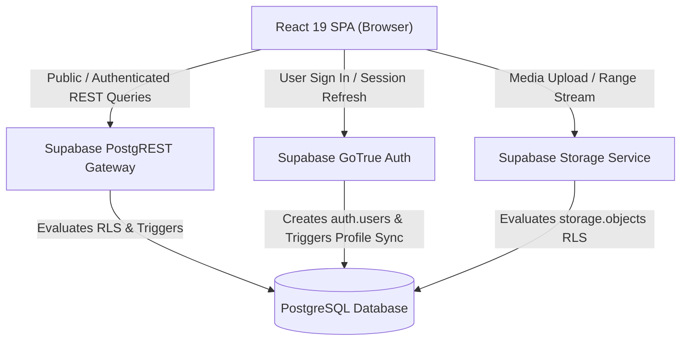

# READERS OF AURANGABAD — SUPABASE BACKEND ARCHITECTURE
**Document Reference:** `docs/SUPABASE_ARCHITECTURE.md`
**Date:** November 9, 2026
**Auditor:** Principal Software Architect & PostgreSQL Security Engineer
**Project Reference:** `rtjulebzjiwbnizqwxjn`
**Status:** APPROVED ARCHITECTURAL SPECIFICATION

---

## 1. System Overview & Architectural Topology

Readers of Aurangabad uses a modern decoupled architecture:
- **Client Application:** React 19 Single-Page Application (SPA) compiled with Vite, styled with Tailwind CSS, running in client browsers.
- **Backend & Database:** Managed Supabase PostgreSQL instance with PostgREST automated REST APIs, GoTrue Authentication, and S3-compatible Object Storage.
- **Security Boundary:** Deny-by-default Row-Level Security (RLS) policies evaluated within PostgreSQL, backed by database triggers for anti-tampering and transactional concurrency controls.



---

## 2. Complete Database Schema Specification

### 2.1 Custom PostgreSQL Enums
1. `public.admin_role`: `'admin'`, `'editor'`
2. `public.registration_status`: `'open'`, `'closed'`, `'announced'`, `'past'`
3. `public.activity_status`: `'new'`, `'contacted'`, `'resolved'`
4. `public.enquiry_type`: `'contact'`, `'volunteer'`, `'book_donation'`, `'collaboration'`

---

### 2.2 Table Definitions

#### A. `public.profiles`
Represents staff and authenticated member profiles linked to Supabase Auth.
* `id` UUID PRIMARY KEY REFERENCES `auth.users(id)` ON DELETE CASCADE
* `email` TEXT NOT NULL UNIQUE (validated via RFC 5322 regex)
* `full_name` TEXT (1 to 150 characters)
* `role` `public.admin_role` DEFAULT NULL (explicitly assigned via admin provisioning)
* `designation` TEXT (1 to 100 characters, e.g. "Founder", "Community Lead")
* `created_at` TIMESTAMPTZ NOT NULL DEFAULT now()
* `updated_at` TIMESTAMPTZ NOT NULL DEFAULT now()

#### B. `public.meetups`
Stores community gatherings, book sessions, and literary events.
* `id` UUID PRIMARY KEY DEFAULT `gen_random_uuid()`
* `title` TEXT NOT NULL (2 to 200 characters)
* `slug` TEXT NOT NULL UNIQUE (2 to 200 characters, URL-safe kebab-case)
* `edition` TEXT (up to 100 characters, e.g. "Chapter 15", "Monsoon Session")
* `starts_at` TIMESTAMPTZ NOT NULL
* `ends_at` TIMESTAMPTZ (CHECK `ends_at IS NULL OR ends_at >= starts_at`)
* `time_label` TEXT (up to 100 characters, human-readable time)
* `venue` TEXT NOT NULL (2 to 200 characters)
* `address` TEXT (up to 500 characters)
* `description` TEXT NOT NULL DEFAULT '' (up to 5000 characters)
* `featured_image` TEXT (URL or storage path up to 500 characters)
* `registration_url` TEXT (External Google Form fallback up to 500 characters)
* `registration_status` `public.registration_status` NOT NULL DEFAULT `'announced'`
* `capacity` INTEGER (CHECK `capacity IS NULL OR (capacity >= 1 AND capacity <= 5000)`)
* `activities` JSONB NOT NULL DEFAULT `'[]'::jsonb`
* `schedule` JSONB NOT NULL DEFAULT `'[]'::jsonb`
* `highlights` TEXT (up to 2000 characters)
* `is_published` BOOLEAN NOT NULL DEFAULT false
* `is_completed` BOOLEAN NOT NULL DEFAULT false
* `created_at` TIMESTAMPTZ NOT NULL DEFAULT now()
* `updated_at` TIMESTAMPTZ NOT NULL DEFAULT now()

#### C. `public.registrations`
Stores attendee RSVPs and event registrations.
* `id` UUID PRIMARY KEY DEFAULT `gen_random_uuid()`
* `meetup_id` UUID NOT NULL REFERENCES `public.meetups(id)` ON DELETE CASCADE
* `name` TEXT NOT NULL (2 to 100 characters)
* `email` TEXT NOT NULL (5 to 255 characters, email regex)
* `phone` TEXT (7 to 20 characters, phone format regex)
* `message` TEXT (up to 1000 characters)
* `consent` BOOLEAN NOT NULL (CHECK `consent = true`)
* `status` `public.activity_status` NOT NULL DEFAULT `'new'`
* `details` JSONB NOT NULL DEFAULT `'{}'::jsonb`
* `created_at` TIMESTAMPTZ NOT NULL DEFAULT now()

#### D. `public.gallery_images`
Community photography showcasing reading sessions and heritage venues.
* `id` UUID PRIMARY KEY DEFAULT `gen_random_uuid()`
* `title` TEXT NOT NULL (2 to 200 characters)
* `caption` TEXT (up to 1000 characters)
* `image_path` TEXT NOT NULL (3 to 500 characters)
* `thumbnail_path` TEXT (3 to 500 characters)
* `alt_text` TEXT (up to 300 characters)
* `meetup_id` UUID REFERENCES `public.meetups(id)` ON DELETE SET NULL
* `display_order` INTEGER NOT NULL DEFAULT 0
* `is_published` BOOLEAN NOT NULL DEFAULT true
* `created_at` TIMESTAMPTZ NOT NULL DEFAULT now()
* `updated_at` TIMESTAMPTZ NOT NULL DEFAULT now()

#### E. `public.reels`
High-definition vertical video reels capturing community moments.
* `id` UUID PRIMARY KEY DEFAULT `gen_random_uuid()`
* `title` TEXT NOT NULL (2 to 200 characters)
* `caption` TEXT (up to 1000 characters)
* `video_path` TEXT NOT NULL (3 to 500 characters)
* `poster_path` TEXT (3 to 500 characters)
* `external_video_url` TEXT (up to 500 characters)
* `duration_seconds` NUMERIC (positive number)
* `display_order` INTEGER NOT NULL DEFAULT 0
* `is_published` BOOLEAN NOT NULL DEFAULT false
* `created_at` TIMESTAMPTZ NOT NULL DEFAULT now()
* `updated_at` TIMESTAMPTZ NOT NULL DEFAULT now()

#### F. `public.announcements`
Time-sensitive notices, news, and book announcements.
* `id` UUID PRIMARY KEY DEFAULT `gen_random_uuid()`
* `title` TEXT NOT NULL (2 to 200 characters)
* `content` TEXT NOT NULL (2 to 5000 characters)
* `action_url` TEXT (up to 500 characters)
* `is_published` BOOLEAN NOT NULL DEFAULT false
* `published_at` TIMESTAMPTZ NOT NULL DEFAULT now()
* `expires_at` TIMESTAMPTZ (CHECK `expires_at IS NULL OR expires_at > published_at`)
* `created_at` TIMESTAMPTZ NOT NULL DEFAULT now()
* `updated_at` TIMESTAMPTZ NOT NULL DEFAULT now()

#### G. `public.articles`
Journal entries, literature essays, poetry, and book reviews.
* `id` UUID PRIMARY KEY DEFAULT `gen_random_uuid()`
* `title` TEXT NOT NULL (2 to 250 characters)
* `slug` TEXT NOT NULL UNIQUE (2 to 250 characters, URL-safe kebab-case)
* `author` TEXT NOT NULL (2 to 150 characters)
* `author_role` TEXT (up to 150 characters)
* `category` TEXT NOT NULL (2 to 100 characters)
* `language` TEXT NOT NULL (2 to 10 characters, e.g. `'en'`, `'mr'`, `'hi'`, `'ur'`, `'mr-IN'`)
* `reading_time` TEXT (up to 50 characters)
* `cover_image` TEXT (up to 500 characters)
* `excerpt` TEXT NOT NULL (10 to 1000 characters)
* `content` TEXT NOT NULL (minimum 10 characters)
* `tags` JSONB NOT NULL DEFAULT `'[]'::jsonb`
* `featured` BOOLEAN NOT NULL DEFAULT false
* `is_published` BOOLEAN NOT NULL DEFAULT false
* `published_at` TIMESTAMPTZ
* `created_at` TIMESTAMPTZ NOT NULL DEFAULT now()
* `updated_at` TIMESTAMPTZ NOT NULL DEFAULT now()

#### H. `public.enquiries`
Visitor contact submissions, volunteer signups, book donation inquiries, and partnerships.
* `id` UUID PRIMARY KEY DEFAULT `gen_random_uuid()`
* `type` `public.enquiry_type` NOT NULL
* `name` TEXT NOT NULL (2 to 100 characters)
* `email` TEXT NOT NULL (5 to 255 characters, email regex)
* `phone` TEXT (7 to 20 characters, phone format regex)
* `message` TEXT NOT NULL (5 to 5000 characters)
* `details` JSONB NOT NULL DEFAULT `'{}'::jsonb`
* `consent` BOOLEAN NOT NULL (CHECK `consent = true`)
* `status` `public.activity_status` NOT NULL DEFAULT `'new'`
* `created_at` TIMESTAMPTZ NOT NULL DEFAULT now()

---

## 3. Concurrency-Safe Meetup Registration Engine

To prevent race conditions during high-demand meetup registrations, `guard_registration_insert` executes an exclusive row lock (`SELECT ... FOR UPDATE`) on the target meetup record before verifying status and capacity:

```mermaid
sequenceDiagram
    autonumber
    actor Attendee as Public Visitor
    participant PostgREST as Supabase Gateway
    participant Trigger as guard_registration_insert Trigger
    participant Meetups as public.meetups (Row)
    participant Regs as public.registrations

    Attendee->>PostgREST: POST /rest/v1/registrations (meetup_id, name, email...)
    PostgREST->>Trigger: Execute BEFORE INSERT
    Trigger->>Meetups: SELECT is_published, registration_status, capacity FOR UPDATE
    Note over Trigger,Meetups: Row locked in exclusive transaction
    alt Meetup is not published or registration_status != 'open'
        Trigger-->>PostgREST: RAISE EXCEPTION 'Registration is not open' (42501)
        PostgREST-->>Attendee: HTTP 403 Forbidden
    else Capacity is reached (count >= capacity)
        Trigger-->>PostgREST: RAISE EXCEPTION 'Capacity reached' (23514)
        PostgREST-->>Attendee: HTTP 409 Conflict
    else Slots Available
        Trigger->>Regs: Normalize name/email; force status='new', details='{}'
        Regs-->>Attendee: HTTP 201 Created (Registration Confirmed)
    end
```

---

## 4. Storage Architecture & Reel Delivery

| Bucket Name | Visibility | Max Size | Allowed MIME Types | Public Access & Delivery Method |
| :--- | :--- | :--- | :--- | :--- |
| `roa-gallery` | **Public** | 20 MB | `image/webp`, `image/jpeg`, `image/png` | Direct Supabase Global CDN (`/storage/v1/object/public/roa-gallery/...`). Upload restricted to Staff. |
| `roa-thumbnails` | **Public** | 10 MB | `image/webp`, `image/jpeg`, `image/png` | Direct Supabase Global CDN. Upload restricted to Staff. |
| `roa-reels` | **Private** | 500 MB | `video/mp4`, `video/webm`, `video/quicktime`, `image/webp`, `image/jpeg`, `image/png` | Storage RLS policy selectively permits streaming of published video matching `reels.video_path` via exact path equality. Supports HTTP Range requests (`HTTP 206 Partial Content`). Draft reels remain strictly invisible. |

---

## 5. Multilingual Content Architecture

Readers of Aurangabad is deeply grounded in the cultural and literary heritage of Maharashtra. The `public.articles` schema supports international language tags:
- `en`: English
- `mr`: Marathi (मराठी)
- `hi`: Hindi (हिन्दी)
- `ur`: Urdu (اردو)
- Region-specific RFC 5646 variants such as `mr-IN`, `hi-IN`, `ur-IN`, `en-IN`.

Database validation constraint:
```sql
check (char_length(trim(language)) between 2 and 10 and language ~* '^[a-z]{2,3}(-[a-z0-9]+)*$')
```
This ensures high international flexibility without artificially limiting the platform to only three languages.
