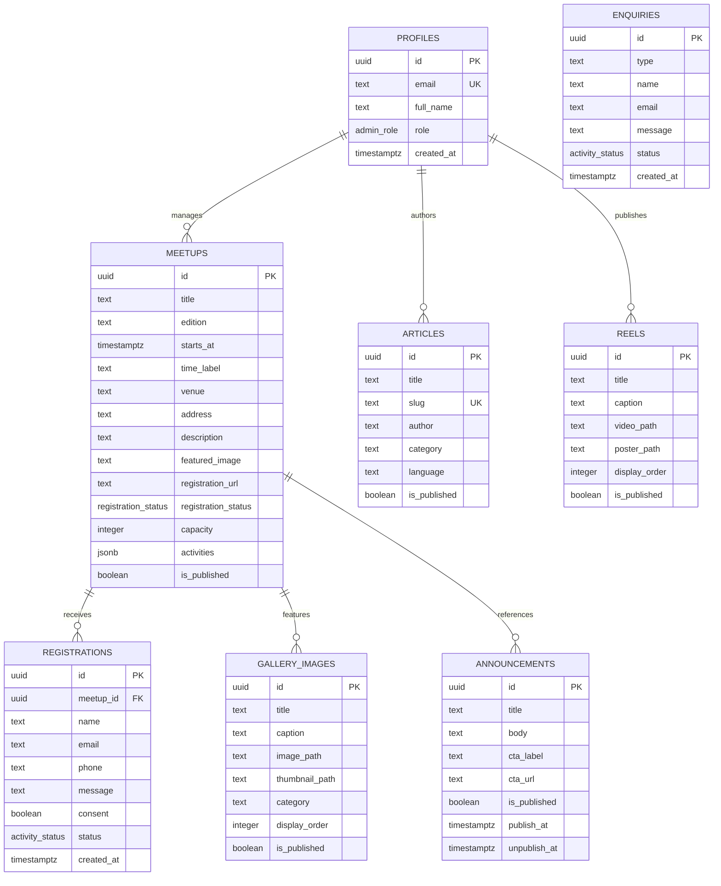
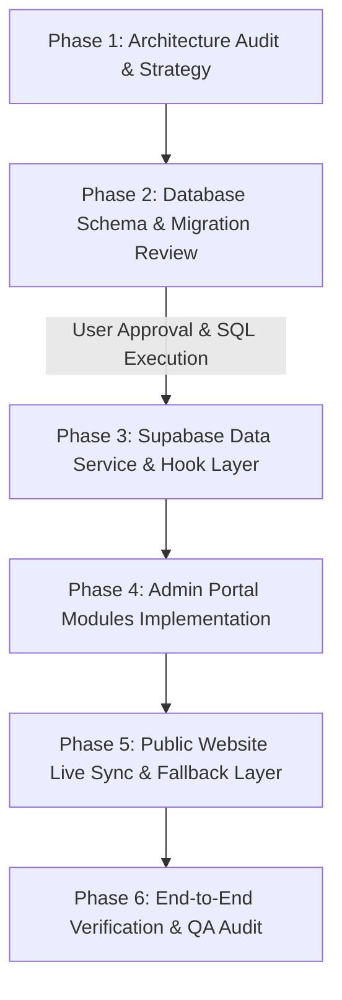

# Readers of Aurangabad — Architecture Audit & Admin Portal Strategy
**Document:** `reports/admin-portal-audit.md`  
**Date:** November 9, 2026  
**Auditor:** Senior Full-Stack Software Architect, Backend Engineer & Security Specialist  

---

## 1. Executive Summary & Project Protection

The **Readers of Aurangabad (MH20)** web platform is a custom literary community platform designed to celebrate reading culture, historic gatherings, reader stories, and public announcements across Aurangabad (Chhatrapati Sambhajinagar). 

### Key Audit Highlights:
1. **Public Website Integrity:** The public frontend is polished, featuring responsive layouts, authentic community photography (`/images/enhanced/`), multilingual typography (English, Hindi, Urdu RTL), audio/video playback, and fluid Framer Motion animations. All existing public routes, visual styling, and brand identity must remain completely untouched.
2. **Existing Backend Integration:** A live Supabase project (`rtjulebzjiwbnizqwxjn.supabase.co`) is already configured in `.env` and connected via `@supabase/supabase-js`.
3. **Primary Architectural Deficit:** Although Supabase credentials and an initial migration script (`supabase/migrations/202611080001_admin_portal.sql`) exist, the database tables and storage buckets **have not yet been applied to the remote Supabase project**. As a result, the application currently falls back entirely to browser `localStorage` and `IndexedDB` for data storage and custom reel videos.
4. **Administrative Gap:** The existing `AdminDashboard.tsx` is an extensive local-state prototype. It lacks real database synchronization, dedicated **Registration Management** (with CSV export and privacy controls), **Announcements Management**, and **Gallery Media Uploads** backed by secure cloud storage.

---

## 2. Existing Frontend & Architectural Audit

### 2.1 Core Technology Stack
| Layer | Technology | Version | Purpose & Implementation |
| :--- | :--- | :--- | :--- |
| **Framework** | React | `19.3.1` | Core UI library using modern functional components, hooks, and Suspense |
| **Language** | TypeScript | `~7.0.2` | Strict type definitions (`src/types/index.ts`) for data entities |
| **Bundler** | Vite | `8.3.5` | Fast ESM development server and Rolldown-optimized production bundler |
| **Styling** | Tailwind CSS | `4.3.4` | Utility-first CSS using `@tailwindcss/vite` |
| **Motion** | Framer Motion | `14.9.1` | Page transitions, hero stagger, scroll reveals, lightbox dynamics |
| **Icons** | Lucide React | `1.68.0` | Editorial iconography + custom Brand/Instagram SVGs |
| **Linter** | oxlint | `1.89.0` | High-performance Rust-based linter |

### 2.2 Design System & Palette
- **Warm Ivory (`#FAF8F5`):** Editorial background canvas (`paper-grain`).
- **Deep Charcoal (`#1C1B1A` / `#20231F`):** Deep text, dark card backgrounds, and hero overlays.
- **Muted Deccan Olive (`#455240` / `#777C60`):** Nature accents, pills, borders, and button accents.
- **Terracotta Clay (`#8D5B4C` / `#A65F46`):** Warm cultural highlights and secondary tags.
- **Antique Gold (`#B89A65`):** Editorial badges, active indicators, and border highlights.
- **Typography:**
  - Headlines: Editorial serif (`font-serif`, Georgia / Playfair).
  - Body: Clean humanist sans-serif.
  - Hindi: Devanagari conjunct support (`font-hindi`, `Noto Serif Devanagari`).
  - Urdu: Nastaliq cursive shaping (`font-urdu`, `Noto Nastaliq Urdu`, `dir="rtl"`, line-height `2.1`).

### 2.3 Routing Model
The application uses a clean state-based client router governed by `currentPage` in [src/context/AppContext.tsx](file:///d:/projects/Readers%20of%20Aurangabad/readers-of-aurangabad/src/context/AppContext.tsx) and [src/App.tsx](file:///d:/projects/Readers%20of%20Aurangabad/readers-of-aurangabad/src/App.tsx):
- Public routes: `home`, `story`, `gatherings`, `journal`, `community`, `get-involved`, `contact`.
- Administrative route: `admin` (rendered via lazy-loaded `<AdminDashboard />`).
- Modals: `MeetupModal`, `ArticleModal`, `VideoFrameExtractorModal`.
- **Navigation Safety:** The `admin` route is completely hidden from the public navigation bar and footer.

---

## 3. Backend, Database & Storage Audit

### 3.1 Live Connectivity Verification
We executed automated network and SDK probes against the project configuration:
- `.env` Configuration:
  ```env
  VITE_SUPABASE_URL=https://rtjulebzjiwbnizqwxjn.supabase.co
  VITE_SUPABASE_PUBLISHABLE_KEY=sb_publishable_...
  ```
- Connectivity Status: **HTTP 200 / Active**. The Supabase client in [src/lib/supabase.ts](file:///d:/projects/Readers%20of%20Aurangabad/readers-of-aurangabad/src/lib/supabase.ts) successfully authenticates against the Supabase API Gateway.
- Schema Status: **Uninitialized**. Remote PostgREST returned error code `PGRST205` (*Could not find the table 'public.meetups' in the schema cache*). No tables or storage buckets currently exist in the remote database.

### 3.2 Existing Local Storage Fallback
Currently, [src/context/AppContext.tsx](file:///d:/projects/Readers%20of%20Aurangabad/readers-of-aurangabad/src/context/AppContext.tsx) handles data via browser storage:
- `localStorage` keys: `roa_meetups_v4`, `roa_articles_v4`, `roa_stories_v4`, `roa_gallery_v4`, `roa_enquiries_v4`, `roa_reels_v1`, `roa_ig_media`.
- `IndexedDB`: `videoStorage.ts` caches user-uploaded video blobs in browser IndexedDB.
- **Drawbacks:**
  - Content edited on one device is not shared with any other user or visitor.
  - Visitors cannot see real-time meetup updates, newly published reels, or live announcements.
  - Browser cache clearing permanently erases all admin changes.
  - Meetup participant registrations are not securely stored on a server.

---

## 4. Backend Architecture Decision & Evaluation

### 4.1 Evaluation of Alternatives
| Criterion | Supabase (PostgreSQL + Auth + Storage) | Firebase (Firestore + Auth + Storage) | Custom Node/Express + SQLite/PG |
| :--- | :--- | :--- | :--- |
| **Existing Project Setup** | **Already integrated** (`@supabase/supabase-js`, `.env`, migrations) | Not installed; would require complete rewrite | Requires dedicated server hosting & maintenance |
| **Data Structure** | **Relational SQL** with foreign keys (`meetups` → `registrations`) | NoSQL Document store; denormalized joins | Relational |
| **Security & Privacy** | **Row Level Security (RLS)** at database kernel | Security Rules syntax | Custom middleware & tokens |
| **Storage Engine** | S3-compatible Supabase Storage with bucket policies | Google Cloud Storage with Firebase rules | Local disk or S3 bucket |
| **Cost & Scalability** | Generous free tier (500MB DB, 1GB Storage, 50k users) | Pay-as-you-go free tier | Server hosting cost ($5–$10/mo) |
| **Administrative Roles** | Database roles (`admin`, `editor`) via `auth.users` trigger | Custom Auth Claims via Cloud Functions | JWT role claims |

### 4.2 Architectural Decision
**Verdict: Supabase is the optimal and natural choice.**  
Supabase is already partially integrated, with pre-existing credentials and well-architected SQL migrations. Switching to Firebase or a custom backend would introduce unnecessary dependencies, redundant migrations, and configuration churn.

---

## 5. Target Database Schema & Storage Architecture

### 5.1 Relational Database Tables
The target schema utilizes PostgreSQL with Row Level Security (RLS) to enforce strict segregation between public and administrative privileges:



### 5.2 Storage Buckets & Policies
1. **`roa-gallery` (Public, 20 MB Limit):**
   - Stores master photographs (`image/jpeg`, `image/webp`, `image/png`, `image/avif`).
   - Public read access for web delivery.
   - Admin-only write/update/delete.
2. **`roa-thumbnails` (Public, 10 MB Limit):**
   - Stores responsive thumbnail crops for fast grid loading.
   - Public read access.
   - Admin-only write/update/delete.
3. **`roa-reels` (Public or Signed CDN, 500 MB Limit):**
   - Stores vertical video files (`video/mp4`, `video/webm`, `video/quicktime`).
   - Delivered via high-performance CDN URLs for seamless continuous playback.
   - Admin-only upload/delete with file size and MIME-type validation.

---

## 6. Admin Portal UI/UX Design & Module Specifications

### 6.1 Route & Access
- Route: `/admin` (accessible via direct URL or keyboard shortcut `Ctrl+Shift+A`).
- **Unauthenticated View:** Minimalist, editorial login interface styled in dark charcoal (`#1C1B1A`) and warm ivory with password reset workflow.
- **Authenticated View:** Full-featured administrative suite with role badge (`Admin` or `Editor`), session status, and instant logout.

### 6.2 Administrative Modules
1. **Executive Dashboard Overview:**
   - Real-time stat cards: Total Registrations, Upcoming Meetups, Published Reels, Gallery Photos, Unread Enquiries.
   - Quick action shortcuts (New Meetup, Upload Reel, Post Announcement).
   - Recent activity feed logging recent actions.
2. **Reels Management (9:16 Video Collection):**
   - Direct file upload with progress bar and MIME validation.
   - In-dashboard preview player.
   - Title, caption, and display order reordering (drag-and-drop or order arrows).
   - Instant toggle for Published / Draft status.
3. **Gallery Management:**
   - Multi-photo upload with thumbnail generation.
   - Title, caption, and category selector (`Reading Together`, `Meetup Moments`, `Community Portraits`, `Behind the Scenes`).
   - Display order management and lightbox preview.
4. **Meetup Management:**
   - Edition number, title, date, time label, venue name, address.
   - Registration status toggle (`open`, `announced`, `closed`, `past`).
   - Agenda & activities editor.
   - Featured cover image selection from enhanced image catalog or cloud upload.
5. **Registration Management (Privacy-Preserving CRM):**
   - Searchable, filterable list of attendees by meetup edition and status (`new`, `contacted`, `resolved`).
   - Detailed modal for individual registrations.
   - **One-click CSV Export** with sanitized fields for field organizers.
   - Strict RLS protection preventing public leakage of participant emails and phone numbers.
6. **Announcements Management:**
   - Announcement banner / editorial notice authoring.
   - Optional call-to-action link (`cta_label`, `cta_url`).
   - Scheduling parameters (`publish_at`, `unpublish_at`).
   - Public website synchronization with [FeaturedAnnouncementReel.tsx](file:///d:/projects/Readers%20of%20Aurangabad/readers-of-aurangabad/src/components/FeaturedAnnouncementReel.tsx).
7. **Literary Journal & Articles Management:**
   - Article editor with language support (`en`, `hi`, `ur`).
   - Excerpt, reading time, author, and category tagging.
   - Featured toggle.
8. **Community Enquiries:**
   - Review incoming contact form and partnership submissions with status tagging.

---

## 7. Implementation Plan



### Phase Details:
- **Phase 1 (Complete):** Deep audit of existing architecture, dependencies, `.env`, local storage, and database state.
- **Phase 2 (Current):** Present recommended schema, storage design, and exact requirements for user review.
- **Phase 3:** 
  - Build `src/services/adminService.ts` and `src/services/publicDataService.ts` wrapping Supabase queries.
  - Implement resilient dual-mode loading: Live Supabase DB when connected, seamless static fallback to `initialData.ts` if offline.
- **Phase 4:**
  - Enhance [src/pages/AdminDashboard.tsx](file:///d:/projects/Readers%20of%20Aurangabad/readers-of-aurangabad/src/pages/AdminDashboard.tsx) with the dedicated Registrations, Announcements, Reels, and Gallery modules.
  - Implement direct Supabase Storage file uploads with client-side compression and validation.
- **Phase 5:**
  - Wire [src/pages/HomePage.tsx](file:///d:/projects/Readers%20of%20Aurangabad/readers-of-aurangabad/src/pages/HomePage.tsx), [CommunityGallery.tsx](file:///d:/projects/Readers%20of%20Aurangabad/readers-of-aurangabad/src/components/CommunityGallery.tsx), [ReelCollectionSection.tsx](file:///d:/projects/Readers%20of%20Aurangabad/readers-of-aurangabad/src/components/ReelCollectionSection.tsx), and [FeaturedAnnouncementReel.tsx](file:///d:/projects/Readers%20of%20Aurangabad/readers-of-aurangabad/src/components/FeaturedAnnouncementReel.tsx) to subscribe to live published data.
- **Phase 6:**
  - Automated testing with Chrome DevTools Protocol across viewports.
  - Verification of CRUD operations, CSV exports, and production builds (`npm run build`, `npm run lint`).

---

## 8. Required Actions & External Setup Needed

To proceed with live cloud synchronization in Phase 3 and beyond, the following one-time setup step is required in your Supabase project:

1. **Apply the Database Migration:**
   - Open your Supabase Dashboard: [https://supabase.com/dashboard/project/rtjulebzjiwbnizqwxjn](https://supabase.com/dashboard/project/rtjulebzjiwbnizqwxjn)
   - Go to the **SQL Editor** tab.
   - Paste and run the contents of [`supabase/migrations/202611080001_admin_portal.sql`](file:///d:/projects/Readers%20of%20Aurangabad/readers-of-aurangabad/supabase/migrations/202611080001_admin_portal.sql).
   - This creates all 8 tables, indexes, RLS policies, storage buckets (`roa-gallery`, `roa-thumbnails`, `roa-reels`), and the administrator trigger.
2. **Create / Invite Admin Account:**
   - In **Authentication > Users**, invite or create an account with email: `imadwahedfarooqui@gmail.com` (or your preferred admin email).
   - The database trigger will automatically grant this user the `admin` role in `public.profiles`.
3. **Approval:**
   - Once reviewed and approved, we will proceed to Phase 3: implementing the production data layer, administrative modules, and live public website synchronization.
